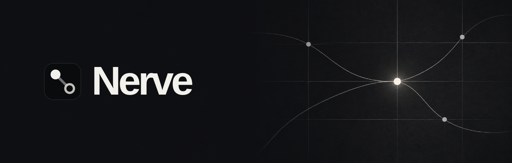
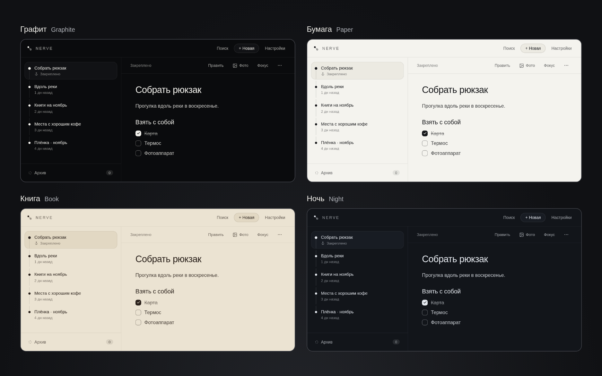
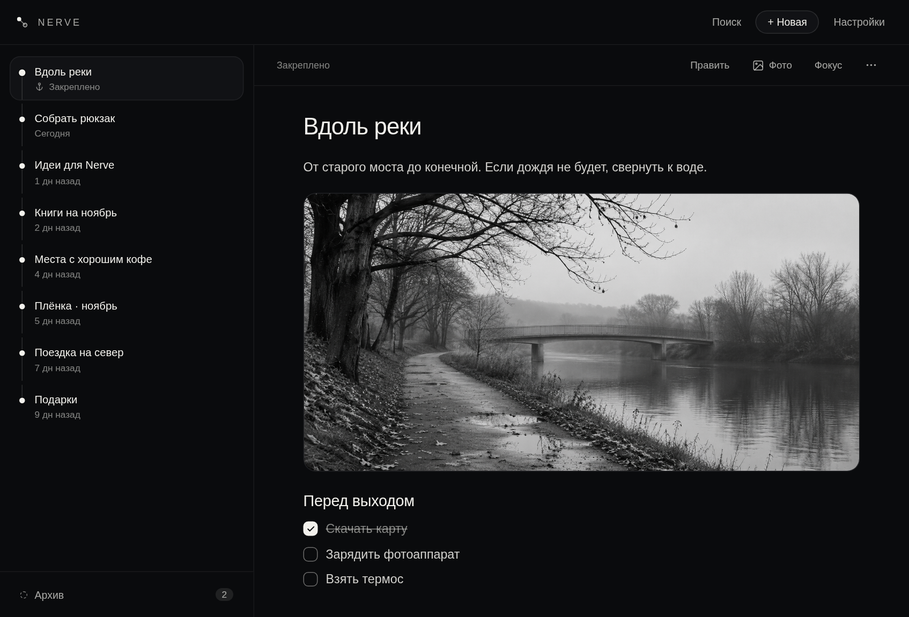
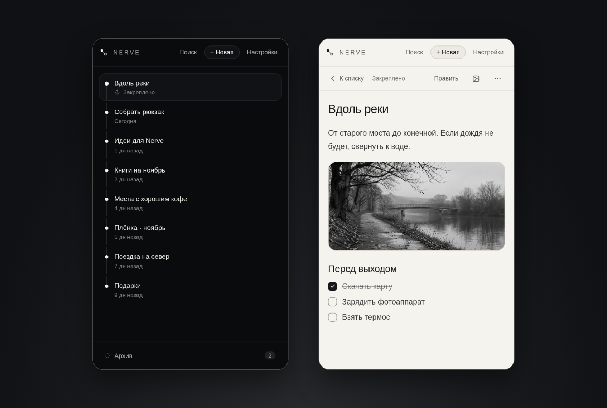

  

  <a href="https://telmik.github.io/Nerve-/Nerve-web-1.4.1/"><strong>Открыть Nerve / Open Nerve</strong></a>
  · <a href="#русский">Русский</a>
  · <a href="#english">English</a>

## Русский

Nerve — бесплатное приложение для заметок.

- Синхронизация заметок между телефоном и компьютером в веб-версии.
- Режим фокуса с таймером. На компьютере откройте заметку и нажмите **F**.
- Старые заметки остывают и со временем уходят в архив. Новые горят ярче всего. Вы можете закрепить заметки, чтобы они не гасли.
- Экспорт заметок в файлы Markdown (`.md`).
- Исходный код веб-версии доступен на GitHub.
- Перенос заметок с фото через бэкап (`.json`). На старом устройстве откройте **Настройки → Данные** и нажмите **Бэкап (.json)**. На новом устройстве выберите **Восстановить (.json)** и откройте этот файл. Восстановление заменит текущие заметки на новом устройстве.
- Четыре темы интерфейса — «Графит» (тёмная), «Бумага» (светлая), «Книга» (бежевая) и «Ночь» (тёмно-синяя).

### Скриншоты

  

  

  

Для синхронизации между устройствами нужен аккаунт. Его можно создать в разделе **Настройки → Аккаунт**.

### Где хранятся заметки

- Без аккаунта заметки и фото хранятся в браузере на вашем устройстве. Если меняете устройство или очищаете данные браузера, сделайте бэкап.
- После входа копии заметок и фото сохраняются в базе Supabase в Лондоне. Каждый пользователь видит в Nerve только свои заметки. Администратор базы может прочитать облачные копии.
- При удалении аккаунта заметки и фото удаляются из рабочей базы Supabase. Локальные копии остаются в браузере.

Желаю приятного использования!

### Обратная связь

[Предложить идею или сообщить об ошибке](https://github.com/Telmik/Nerve-/issues/new)

### FAQ

**Работает ли Nerve без интернета?**

Да. После первого открытия веб-версии с интернетом можно читать и редактировать заметки офлайн. Если вы вошли в аккаунт, изменения синхронизируются, когда связь вернётся.

**Планируется ли релиз мобильного приложения?**

Да, планирую выпустить его в ближайшее время.

**Как синхронизировать телефон и компьютер?**

Откройте веб-версию на обоих устройствах и войдите в один аккаунт. Синхронизация работает автоматически. Чтобы запустить её вручную, откройте **Настройки → Аккаунт** и нажмите **Синхронизировать**.

**Куда пропала моя заметка?**

Загляните в **Архив** внизу списка. По умолчанию заметки уходят туда через 30 дней без изменений. Их можно вернуть в список.

## English

Nerve is a free note-taking app.

- Sync notes between your phone and computer in the web app.
- Focus mode with a timer. On a computer, open a note and press **F**.
- Old notes cool down and eventually move to the archive. New notes burn brightest. Pin the ones you want to keep warm.
- Export notes as Markdown files (`.md`).
- The web app's source code is available on GitHub.
- Move notes and photos with a `.json` backup. On your old device, go to **Settings → Data** and choose **Backup (.json)**. On your new device, choose **Restore (.json)** and open that file. Restoring the backup replaces the notes on your new device.
- Four themes — Graphite (dark), Paper (light), Book (beige), and Night (dark blue).

[View screenshots](#скриншоты)

You need an account to sync between devices. Create one under **Settings → Account**.

### Where your notes are stored

- Without an account, your notes and photos are stored in your browser on your device. Make a backup before switching devices or clearing your browser data.
- After you sign in, copies of your notes and photos are stored in a Supabase database in London. Each user can only see their own notes in Nerve. The database administrator can read the cloud copies.
- Deleting your account removes your notes and photos from the live Supabase database. Local copies stay in your browser.

Enjoy using Nerve!

### Feedback

[Suggest an idea or report a bug](https://github.com/Telmik/Nerve-/issues/new)

### FAQ

**Does Nerve work offline?**

Yes. After opening the web app online for the first time, you can read and edit notes offline. If you're signed in, your changes sync when you reconnect.

**Is a mobile app release planned?**

Yes. I plan to release it soon.

**How do I sync my phone and computer?**

Open the web app on both devices and sign in to the same account. Your notes sync automatically. To start a sync manually, go to **Settings → Account** and click **Sync now**.

**Where did my note go?**

Check the **Archive** at the bottom of the note list. By default, notes go there after 30 days without changes. You can restore them to the list.
